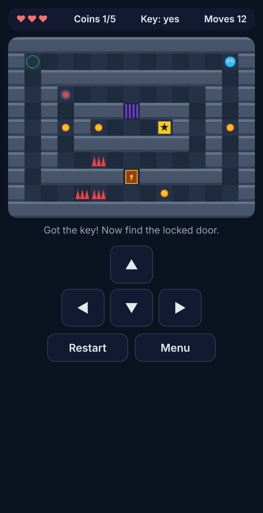

# MazeQuest Mini

A tiny top-down puzzle adventure that runs in the browser (phone friendly, no install).



## Play
Open `index.html` in a browser, or host the folder with GitHub Pages.

**Goal:** grab the key, open the door, press the switch to open the gate, dodge the spikes and reach the star. Coins are optional.

**Controls:** arrow keys or WASD, the on-screen pad, or tap the board. `R` restarts, `Esc` opens the menu.

**Stars:** 1 for finishing, +1 for all 5 coins, +1 for no spike hits.

## Docs
- [PRD.md](PRD.md): product requirements
- [mockups/ui-mockups.svg](mockups/ui-mockups.svg): UI mockups
- [screenshots/](screenshots/): screenshots of the built game

## Project structure
```
index.html   page layout
style.css    theme
logic.js     game rules (no DOM)
main.js      rendering and input
test.js      rule tests
```

## Tests
```bash
node test.js
```
Covers walls, locked door, key, checkpoint, traps, game over, gate, and a full 60-move solution.

## Built with
Vibe coded with Claude: PRD first, then mockups, then the game, then tests and a headless-browser playthrough.
