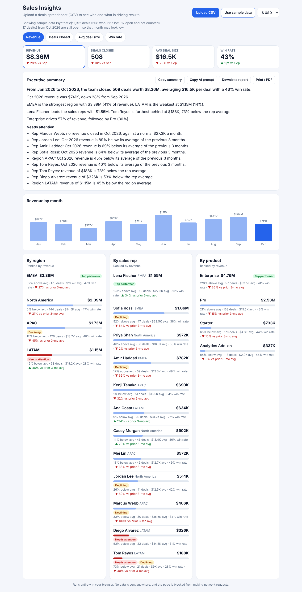

# Sales Insights Dashboard

A private, shareable sales dashboard for monthly review meetings. Upload a deals spreadsheet (CSV) and get rankings by **region, rep and product**, **top performers and problem areas**, a **plain-language executive summary**, and a **metric switcher** (revenue, deals closed, average deal size, win rate).



## Try it
Open `index.html` (or the GitHub Pages link), then tap **Use sample data** or **Upload CSV**. No install, no build step, no server.

## How it meets the brief
| Requirement | How |
|---|---|
| Summarize by region, rep, product | Three ranked panels with bars, deal counts, average deal size, win rate |
| Highlight top performers and areas needing attention | Badges: **Top performer**, **Needs attention** (far below the group average), **Declining** (latest month sharply below its recent baseline and falling faster than the team) |
| Short plain-language executive summary | Generated from the numbers: headline, month-on-month move, best and weakest region, rep leader and laggard, product mix, and a watchlist |
| Switch between metrics | Tabs or tap a KPI card. Panels, ranking, flags and the monthly chart all follow the metric |
| Data stays private (uploaded spreadsheets only) | Everything runs in the browser tab. A Content Security Policy (`connect-src 'none'`) blocks all network requests, so the page *cannot* send data out. Verified in a browser test |
| Easily shareable | Host the folder on GitHub Pages and share the link (each person loads their own file). **Download report** saves a standalone HTML snapshot with aggregated numbers only (no scripts, no deal rows). **Print / PDF** and **Copy summary** also work |
| Test dataset | `sample_data/sales_sample.csv`: 1,192 synthetic deals, 12 reps, 4 regions, 4 products, Jan to Oct 2026, generated by `tools/make_sample.py` |

## About the "AI-assisted" part
The summary is written by a local rule-based engine, not a cloud model, because sending sales data to an AI service would break the privacy constraint. For a richer write-up, **Copy AI prompt** builds a prompt containing only aggregated totals (no deal-level rows or IDs) that can be pasted into any AI chat.

## Input format
CSV with columns for `region`, `sales rep`, `product`, `amount`; optionally `status` (won / lost / open) and `close date`. Common alternative names are recognised (territory, owner, plan, deal value, stage...). Comma, semicolon and tab separated files work. Dates: `2026-03-15`, `15.03.2026`, `15/03/2026`, `03/15/2026` (ambiguous dates read as month first). Amounts like `$1,234.50` and `1.234,50` are handled. Rows with an unreadable amount are skipped and reported on screen.

## Decisions worth knowing
- Only **won** deals count as revenue; **open** deals are excluded and the screen says when the latest month still has open deals.
- "Declining" compares the latest month with the average of up to 3 earlier months, not just the previous month, because one large deal can swing a single month by 30% or more.
- Products are flagged only when declining. Being a cheaper product line is not a problem by itself.

## Limitations
CSV only (export from Excel or Sheets). One currency symbol for the whole file. The narrative is templated, so it is accurate but not creative.

## Files
```
index.html     page, styles and privacy policy
analysis.js    parsing, metrics, flags, summary (no DOM, unit tested)
app.js         rendering and sharing
sample.js      sample data embedded so the page works from a local file
sample_data/   sales_sample.csv
tools/         make_sample.py (seeded generator)
test.js        19 tests: node test.js
```

## Tests
```bash
node test.js
```
Covers parsing (quotes, delimiters, encodings, dates, amounts), column aliases, error handling, that totals equal the sum of every breakdown, that open deals never count, the flag logic, and summary wording. A headless-browser run also checked metric switching, phone layout, hostile input (HTML in names is shown as text, never executed), the report download, and the network block.

Built with Claude (vibe coded): requirements first, then sample data, then logic with tests, then UI and a browser check.
